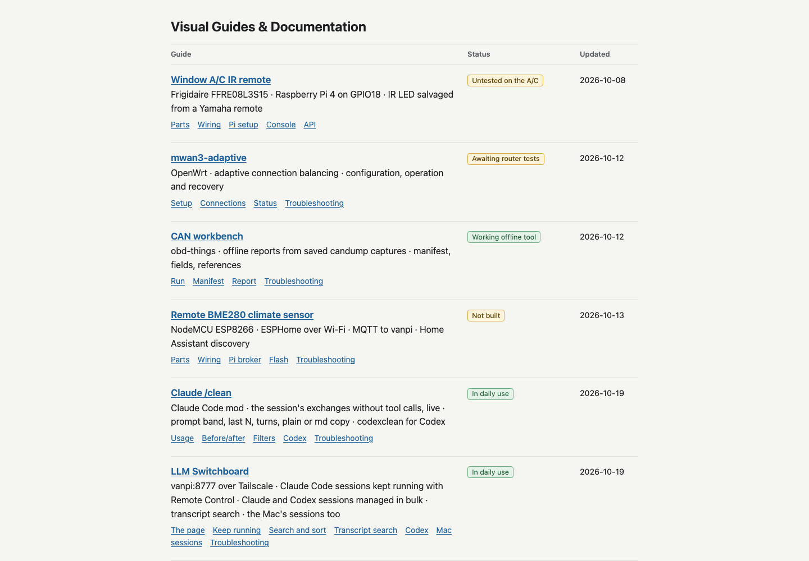
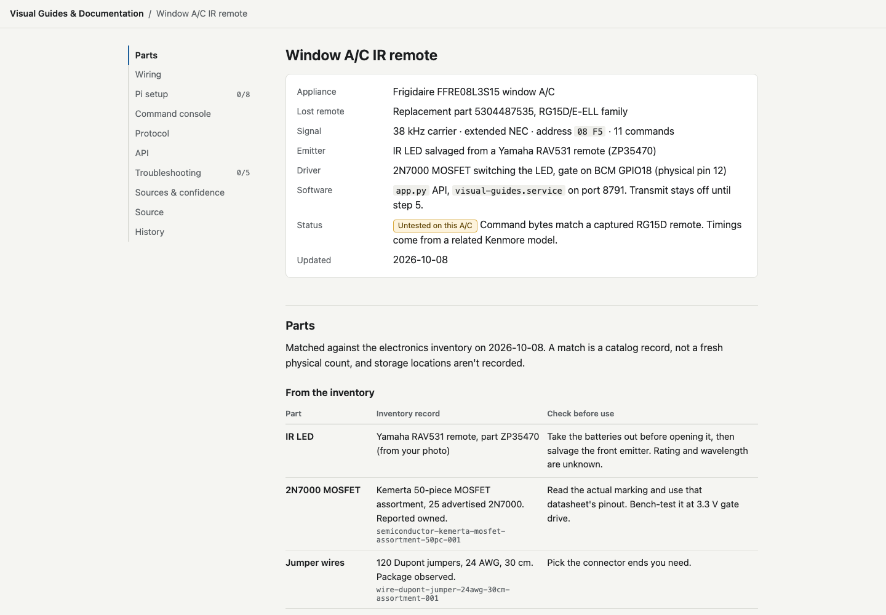

# Visual Guides & Documentation

Local documentation library and guarded A/C infrared controller.

## Screenshots

| Guide library | A/C reference and controller |
|---|---|
|  |  |

- Mac: [localhost:8792](http://127.0.0.1:8792).
- Pi: [vanpi.lan:8791](http://vanpi.lan:8791).
- Source: [JakeIwen/visual-guides](https://github.com/JakeIwen/visual-guides).

This standalone repository retains the guide history extracted from
`JakeIwen/scripts`. The checkout is `~/dev/visual-guides`.

- [Window A/C IR remote](http://vanpi.lan:8791/guides/air-conditioner.html)
- [mwan3-adaptive](http://vanpi.lan:8791/guides/mwan3-adaptive.html): illustrated
  setup, policy selection, observation/active modes, status and recovery for the
  unpublished 0.2.0-r1 OpenWrt candidate. Page controls only prepare scripts and
  illustrations; there is no router API or automatic installation.
- [CAN workbench](http://vanpi.lan:8791/guides/can-workbench.html): running the
  obd-things offline CAN report CLI, its manifest format and reading its reports.
  Static reference only; it reads no captures.
- [Claude /clean](http://vanpi.lan:8791/guides/clean-output.html): the
  clean-output Claude Code mod: exchanges with their prompts, last N, all,
  turn endings, before/after output, adding filters.
- [llmrestore](http://vanpi.lan:8791/guides/llmrestore.html): reopening Claude
  Code and Codex sessions after a reboot, the restore window, Pi sessions from
  the Mac and the snapshot cron.

Python 3.10+ standard library only; no npm build, external fonts, or CDN.
Node is used for JavaScript checks and optional npm command aliases.

## Files

- `app.py`: HTTP server, static serving, authorization and CLI client. Real CLI
  sends use the same running API admission path as the browser.
- `ac_ir.py`: canonical command contract/catalog, waveform encoding and serialized
  `ir-ctl` transport. Change the catalog here; the UI loads it from the API.
- `hardware_setup.py`: explicit owner-operated GPIO18 boot/udev configuration and
  systemd activation/deactivation. Status and prepare are read-only.
- `deploy.py` and `visual-guides.service`: separate immutable Pi releases and
  guarded systemd install; independent of the dashboard package deployer.
- `static/`: guide index, A/C guide and first-test reference script. Shared
  styles are in `assets/site.css`, with colors and light/dark overrides in
  `assets/palette.css`; `guides/air-conditioner.js` owns the
  step checklists, copy buttons, LED current estimate, preview-only console and
  the catalog table built from `/api/ac/commands`. This is the only HTTP-served
  directory. `guides/mwan3-adaptive.css` and `guides/mwan3-adaptive.js` own the adaptive
  guide's diagrams, policy command generation and shell-script downloads.
  `reference/mwan3-adaptive-{readme,validation}.txt` are snapshots of that
  candidate's package documentation; refresh them and the guide together when
  updating the documented version. General typography stays in `site.css`.
- `tests/test_app.py`, `test_deploy.py`, `test_hardware_setup.py`: behavioral and
  deployment-contract tests.

To add a guide, add its page under `static/guides/` and a list entry in
`static/index.html`. Keep hardware-specific APIs explicit. Pages use plain
headings and show reference content immediately, without slogans or promotional
copy.

## Editing and history

Edit the files in this checkout, then refresh the local Mac page to preview.
Each guide's Source and History links open its source and revisions on GitHub.
Use `git log --follow -- static/guides/<name>.html` for local page history.
Shared styles remain under `static/assets/`; each guide's private CSS and JavaScript
live beside its HTML with the same basename under `static/guides/`.

The Mac serves current working files; the Pi serves the last deployed release.
After reviewing an edit, use the combined deployment command below. It also
reloads Python on the Mac. Deployment uses your current working files and does
not commit, push, or pull Git changes; keep source history with your usual Git
workflow.

For continuous Mac hosting, see [Mac hosting](docs/local-hosting.md). Its
launchd service starts at boot, runs preview-only on loopback port 8792, and
supports `npm run service:status` and `npm run service:verify`.

## Deploy to both hosts

From `~/dev/visual-guides`:

```sh
npm run deploy
```

This checks the installed Mac service and the Pi deployment first, runs all
tests and JavaScript syntax checks, gracefully restarts the Mac through launchd,
deploys an immutable Pi release, and verifies the Mac is still supervised.
Both services remain enabled at boot. An unchanged, healthy Pi release is
verified without restarting it or replacing its previous-release rollback link.

The Mac service must already be installed; the Pi must be reachable over SSH at
`pi@vanpi.lan`. Missing supervision or failed preflight stops the command before
deployment. Later failures stop the sequence and return nonzero. The two hosts
are not one atomic transaction: if Pi deployment fails, the Mac may already be
updated; the Pi deployer retains its existing rollback behavior. Fix the reported
problem and rerun the same command.

For read-only host checks, use `npm run deploy:check`. For a Pi-only deployment,
use `npm run deploy:pi`. Mac HTML/CSS/JS edits appear on refresh immediately;
there is no automatic save watcher, GitHub poller or background Pi deployment.

## Run locally

For a temporary foreground preview when the Mac service is stopped:

```sh
python3 app.py --bind 127.0.0.1 --port 8792
```

Open `http://localhost:8792`. Default mode never opens the IR device. Preview a
command without any server or token:

```sh
python3 app.py --preview temp_up
python3 app.py --list-commands
```

## Deploy to the Pi

From this directory on the Mac:

```sh
python3 deploy.py check
python3 deploy.py apply
python3 deploy.py status
```

Default target is `pi@vanpi.lan`. Read-only preflight checks the service, release
ownership and port. Apply transfers allowlisted code and static assets to
`/home/pi/visual-guides/releases/<digest>`, creates a private persistent token,
switches `current`, retains `previous`, enables/restarts only
`visual-guides.service`, and verifies health. A failed cutover restores the
previous release/unit. No boot configuration, GPIO transmission or reboot is
part of deployment. No old release is automatically removed.

The base unit starts in preview mode. An explicitly installed hardware drop-in
survives routine deployments; use the setup controller to deactivate it. The
service listens on port 8791 on IPv4 interfaces, so the docs are readable on LAN
and Tailscale. It does not configure external port forwarding or TLS. Real sends
require a private bearer token and same-origin requests; scripts may omit Origin.
On untrusted networks use SSH forwarding, as shown in the guide.

## Hardware handoff

Read the guide first. GPIO18 (physical12) was unused at inspection; GPIO17 is
already occupied by the alert lamp. The controller rechecks current ownership.
The donor LED's rating and MOSFET pinout must be checked physically. Do not
connect the LED directly to GPIO or omit its series resistor.

On the Pi, as `pi` (the helper invokes sudo only for fixed privileged operations):

```sh
cd /home/pi/visual-guides/current
python3 hardware_setup.py status
python3 hardware_setup.py prepare
python3 hardware_setup.py configure --confirm-wiring
```

Configure backs up the active boot configuration byte-for-byte in private
`~/.local/state/visual-guides/`, adds the managed gpio-ir-tx GPIO18 block, and
installs a driver-specific udev rule for `/dev/van-ac-ir-tx`. It refuses unrelated
pin owners, conflicting overlays and foreign managed-file contents. It does not
load a live overlay or reboot. After safely scheduling a manual reboot:

```sh
python3 hardware_setup.py status
python3 hardware_setup.py activate --confirm-wiring
```

Activation verifies GPIO ownership, LIRC sysfs driver and TX-only features,
installs the hardware service drop-in, and waits for API health. It does not emit
IR. To restore preview-only API operation:

```sh
python3 hardware_setup.py deactivate
```

The boot overlay stays installed. The guide's first-test script is reference
text, never a secret. The browser console only previews; real sends go through
the CLI on the Pi or the first-test script. The token lives only at
`/home/pi/.config/visual-guides/api-token`, mode 0600, and is never included in
static assets, API responses, command arguments or deployment logs.

## Protocol and API

The exact model is FFRE08L3S15 (zero after FFRE). A supplier lists OEM replacement
5304487535, another identifies that remote as RG15D/E-ELL, and the pinned
[CC0 Frigidaire RG15D capture](https://github.com/Lucaslhm/Flipper-IRDB/blob/d126fb1b6f1e114c52b4a8c19839ea65e3a9c24d/ACs/Frigidaire/Frigidaire_RG15D_AC.ir)
agrees with every command in the catalog. Raw timing comes from the
[measured Kenmore 253.79081 LIRC capture](https://lirc.sourceforge.net/remotes/Kenmore/Kenmore_253_79081).
All sources, confidence limits and electrical references are in the guide.
Physical compatibility with this individual A/C remains untested.

38 kHz, extended NEC, logical address `08 F5`; logical bytes are sent LSB-first.
Legacy LIRC printed `10 AF` is its MSB representation, not the logical address to
pass unchanged to Linux. Temperature up is Linux `necx:0x08f50e`. Each tap sends
one full frame. Held-key repeats, remote sensing and arbitrary raw waveforms are
not exposed.

| Endpoint | Behavior |
| --- | --- |
| `GET /api/health` | Service health |
| `GET /api/ac/status` | Hardware enable state; actual A/C state unknown |
| `GET /api/ac/commands` | Canonical catalog, sources and waveform previews |
| `POST /api/ac/commands/<name>` | Exactly `{"preview":true}` or `{"preview":false}` |

`Content-Type: application/json` is required. Preview needs no token. Actual
transmission requires hardware-enabled service plus `Authorization: Bearer …`.
Commands include temperature up/down, power toggle, cool, fan-only, fan up/down,
auto fan, energy saver, sleep and timer. No absolute temperature or discrete
power on/off is asserted. Timer/sleep behavior needs particular care during
physical validation. Command and transport metadata are generated from the
canonical catalog, not duplicated in the frontend.

Delivery `dry_run` means no signal was sent; `transmitted` means `ir-ctl`
completed, with `confirmed:false` in both cases. No A/C state is guessed. There
is a one-second cooldown after each real attempt, including failures. No retry
or redirect is followed for CLI real sends. A failed/timeout attempt may already
have emitted IR; inspect the A/C before repeating a toggle.

## Verification

Run `npm test` for all checks, or from this directory:

```sh
python3 -m unittest discover -s tests -v
python3 -m unittest test_deploy test_hardware_setup -v
node --check static/guides/air-conditioner.js
node --check static/guides/mwan3-adaptive.js
```

Tests exercise real local HTTP calls with an injected recording transport; they
never emit IR. Hardware configure/activate branches are tested with mocked
operating-system boundaries. Browser QA covers desktop and 390px mobile layouts,
preview buttons, source links and script/style loading. Live
validation checks systemd boot enablement, guide/API health and preview mode.
Actual LED performance, udev matching after reboot and A/C acceptance require
owner bench validation.
